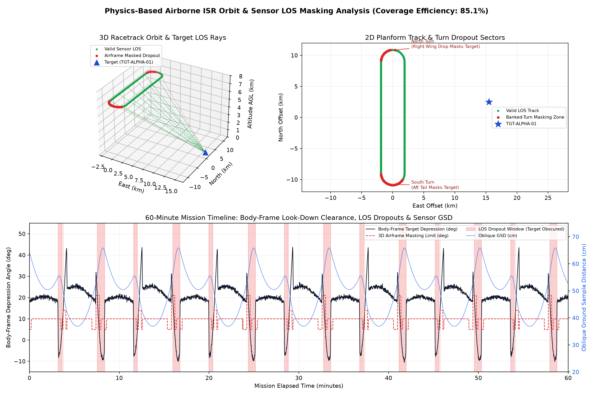

# Physics-Based Airborne ISR Orbit & Sensor LOS/Telemetry Modeler (`isr-sensor-los-modeler`)


## Overview
`isr-sensor-los-modeler` is a hybrid **ISO C11** and **Python** engineering repository demonstrating embedded kinematic telemetry ingestion, sensor-fusion vibration filtering, and discrete-event 3D airborne Intelligence, Surveillance, and Reconnaissance (ISR) Line-of-Sight (LOS) modeling.

The architecture bridges low-level flight/gimbal hardware telemetry parsing (modeled around an **ESP32-S3** microcontroller interfacing with an **NMEA-0183** GNSS receiver and **MPU-9250** 9-axis IMU) with mission-level standoff orbit geometry, 3D airframe structural masking analysis, and optical Ground Sample Distance (GSD) calculations.

> **OPSEC & Classification Notice:** All orbit geometries, airframe masking envelopes, optical parameters, and telemetry streams are **100% unclassified and mathematically synthesized** from first-principles flight dynamics and pinhole optics.

## Technical Capabilities

### 1. Embedded C11 Telemetry Parser & Vibration Filter (`src/telemetry_parser.c`)
* **Zero-Heap NMEA-0183 Finite State Machine:** Parses streaming byte-by-byte `$GPGGA` and `$GPRMC` UART frames without dynamic memory allocation (`malloc`) or destructive `strtok` calls, preserving null/empty CSV fields and rejecting corrupted UART packets via bitwise XOR checksum verification.
* **MPU-9250 9-Axis Scaling & Jitter Mitigation:** Scales signed 16-bit ADC registers (`16,384 LSB/g`, `131 LSB/(deg/s)`, `0.15 uT/LSB`) and cascades a first-order IIR structural low-pass filter with a complementary attitude & tilt-compensated heading filter, achieving **>14 dB RMS attenuation** of 18 Hz airframe vibration jitter.

### 2. 6-DOF Discrete-Event Orbit & Airframe Masking Simulator (`sim/sensor_los_sim.py`)
* **$C^1$-Continuous Racetrack Kinematics:** Models a 60-minute (3,600-second) standoff ISR mission at 6,400 m AGL and 95 m/s true airspeed with coordinated $26^\circ$ banked 180-degree turnarounds and smooth cosine roll-in/roll-out transitions.
* **3D NED-to-Body Coordinate Transformation:** Applies a 3-2-1 aerospace Euler rotation ($\mathbf{R}_{\text{NED}\to\text{Body}} = R_x(\phi)R_y(\theta)R_z(\psi)$) at every 1-second step to evaluate target azimuth and depression in the **aircraft body frame**, isolating exact LOS dropouts when the dropping wing/pylon or aft empennage sweeps across the belly-mounted turret's line of sight.
* **Oblique Optical GSD & Swath Physics:** Computes instantaneous slant range, grazing angle $\psi_g$, cross-track swath width, and foreshortened oblique Ground Sample Distance ($GSD_{\text{eff}} = \frac{R_s \cdot \text{IFOV}}{\sqrt{\sin \psi_g}}$).

## Diagnostic Output Preview


## Quickstart & Execution

### Prerequisites
* **C Compiler:** MSVC (`cl.exe` via Visual Studio C++ Workload) or `gcc` / `clang`
* **Python 3.10+:**
  ```bash
  pip install -r requirements.txt